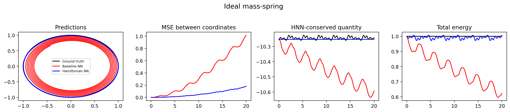
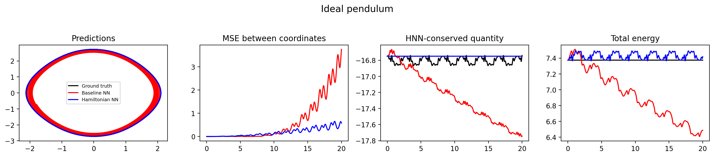
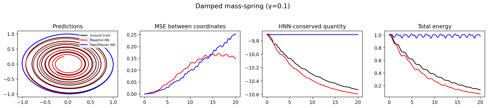
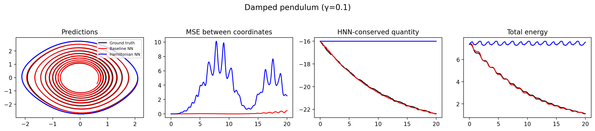
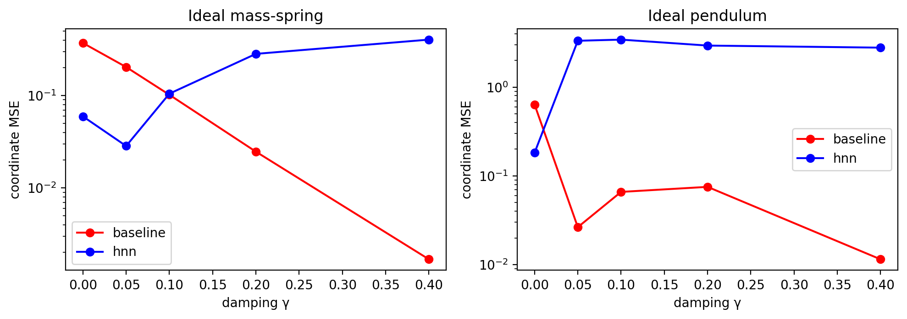
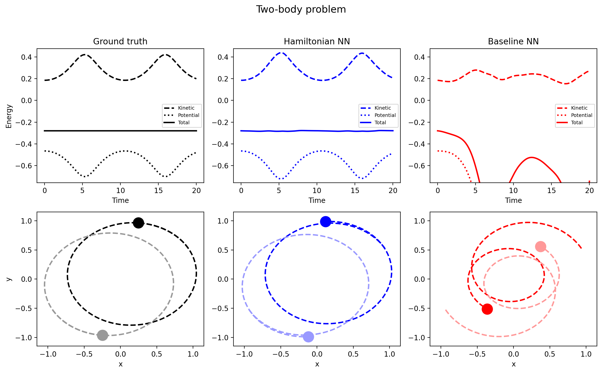
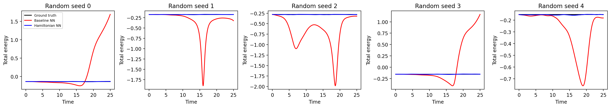

# Hamiltonian Neural Networks: learning physics that conserves energy

A PyTorch comparison of a **Hamiltonian Neural Network (HNN)** against a standard neural network (the **baseline**) for learning the dynamics of physical systems from data. Both models have the same architecture, data and training procedure. The only difference is what the network outputs, and that turns out to matter a lot when the learned model is used as a simulator.



## The idea

The usual way to learn dynamics is to train a network to predict the time derivative of the state, then simulate by stepping that prediction forward. Small errors accumulate, and the simulated system slowly gains or loses energy that a real frictionless system would keep exactly.

An HNN instead learns a single scalar, the Hamiltonian $H(q, p)$, and gets the motion from Hamilton's equations using automatic differentiation:

$$\frac{dq}{dt} = \frac{\partial H}{\partial p}, \qquad \frac{dp}{dt} = -\frac{\partial H}{\partial q}$$

Whatever function the network learns, the motion it generates conserves that function exactly. Energy conservation is built into the architecture instead of being learned from data.

| Model | Network output | Conservation |
|---|---|---|
| **Baseline** | the derivatives $(dq/dt,\ dp/dt)$ directly | none, must be learned |
| **HNN** | one scalar $H$; derivatives come from its gradient | exact, by construction |

## Experiments

| Section | System | What it tests |
|---|---|---|
| 1 | Ideal mass-spring | A linear system with exact energy conservation |
| 2 | Ideal pendulum | A nonlinear system, still conservative |
| 3 | Damped spring and pendulum, plus a sweep over damping $\gamma$ | What happens when energy is *not* conserved |
| 4 | Two-body gravitational orbit (8-dimensional state) | A larger, strongly nonlinear system |

Each model is evaluated on three metrics:

1. **Single-step accuracy:** train and test MSE of the predicted derivatives.
2. **Energy MSE:** after simulating from 15 start points, how far the true energy along the model's path drifts from the true energy along the true path.
3. **Coordinate MSE:** how far the simulated path is from the true path, from a fixed start point.

## Results

Values are raw (not scaled), with standard errors where available. Lower is better, and the better model in each pair is in bold where the gap is clear. Source: [`results/tables/all_metrics.csv`](results/tables/all_metrics.csv).

| System | Model | Test MSE | Energy MSE | Coordinate MSE |
|---|---|---|---|---|
| Ideal mass-spring | Baseline | 0.0394 ± 0.0020 | 0.0414 ± 0.0102 | 0.371 |
| | HNN | 0.0359 ± 0.0018 | **0.000301 ± 0.000118** | **0.0596** |
| Ideal pendulum | Baseline | 0.0617 ± 0.0045 | 0.00245 ± 0.00041 | 0.637 |
| | HNN | 0.0618 ± 0.0046 | **0.00142 ± 0.00013** | **0.182** |
| Damped mass-spring (γ=0.1) | Baseline | 0.0365 ± 0.0019 | **0.00823 ± 0.00204** | 0.102 |
| | HNN | 0.0364 ± 0.0019 | 0.425 ± 0.107 | 0.105 |
| Damped pendulum (γ=0.1) | Baseline | 0.0660 ± 0.0047 | **0.00185 ± 0.00017** | **0.0660** |
| | HNN | 0.0681 ± 0.0047 | 1.11 ± 0.24 | 3.43 |
| Two-body | Baseline | 3.22e-5 ± 8.3e-7 | 0.464 ± 0.170 | n/a |
| | HNN | **4.36e-6 ± 5.8e-8** | **6.52e-6 ± 4.6e-7** | n/a |

Test MSE is the error of the predicted derivatives, energy MSE is the drift in true energy along simulated paths, and coordinate MSE is the distance from the true path (single start point, so noisier). The two-body system has no coordinate MSE because the notebook does not compute one for it.

### Frictionless systems

On the single-step loss the two models are about equal (the spring's small HNN advantage is within roughly 1.3 standard errors, and on the pendulum they are the same). They differ as simulators:

- **Mass-spring:** the HNN's energy error is about 140× lower than the baseline's, and its coordinate error is about 6× lower.
- **Pendulum:** the HNN's energy error is about 1.7× lower (a gap of roughly two standard errors) and its coordinate error is about 3.5× lower.

The baseline's energy drifts and its paths spiral, while the HNN keeps its energy bounded.




### Systems with friction

An HNN can only move along contours of one function $H$, so it cannot represent a system whose energy changes. The baseline has no such restriction, and at γ = 0.1 the HNN's advantage is gone:

- **Damped mass-spring:** both models fit the data equally well and their coordinate errors are about the same (0.102 vs 0.105), but the HNN's energy error is about 50× higher, because it keeps the energy roughly constant while the true system loses it.
- **Damped pendulum:** the HNN is much worse, with an energy error about 600× higher and a coordinate error about 50× higher than the baseline.




The sweep over $\gamma \in \{0, 0.05, 0.1, 0.2, 0.4\}$ plots coordinate MSE against damping strength for both models:



### Two-body problem

With an 8-dimensional state and clean inputs, the HNN reaches a test loss about 7× lower than the baseline's, and its energy error is about five orders of magnitude lower (6.5e-6 vs 0.46, roughly 70,000×).




## Setup used

| | Spring, pendulum, damped | Two-body |
|---|---|---|
| Architecture | MLP, 2 hidden layers × 200, tanh, orthogonal init, no bias on last layer | same |
| Optimiser | Adam, lr 1e-3, weight decay 1e-4 | Adam, lr 1e-3, no weight decay |
| Training | 2000 full-batch steps | 10,000 steps, minibatch 200 |
| Data | 50 trajectories, 3 time units, 30 or 45 points each, first half train, second half test | 1000 orbits × 50 points over 20 time units, 20% test |
| Input noise | Gaussian, std 0.1 (inputs only, labels exact) | none |
| Seed | 0 | 0 |

Two details worth knowing:

- **Noise and `time_scale`.** Noisy inputs with clean labels make a network learn a slightly shrunk derivative, so the learned spring oscillates a little slower than the real one. For the spring only, learned paths are integrated for 1.09× the time (`time_scale=1.09`) so the coordinate error reflects modelling error and not only phase lag. The pendulum and the other systems use 1.0.
- **Energy metric.** The 15 start points partly lie outside the radii used in training, so the energy MSE also checks extrapolation.

## Running it

```bash
git clone https://github.com/Swayam-Verma3350/Hamiltonian-Neural-Network.git
cd Hamiltonian-Neural-Network
pip install -r requirements.txt
jupyter notebook notebooks/HNN_notebook.ipynb
```

Run all cells. The notebook writes figures, metric tables, trained weights and a `results.zip` to a `results/` folder next to where it is run. Training the spring, pendulum and damped systems takes a few minutes on a CPU, and the two-body run (10,000 steps per model) takes longer.

## Repository structure

```
notebooks/    HNN_notebook.ipynb   all code, with explanations
results/
  figures/    PNG plots used above
  tables/     per-system metrics, all_metrics.csv, gamma sweep
  models/     trained weights (.pt), two-body energy curves (.npz)
report/       full write-up
```

To reload a trained model: build it with `make_mlp(in_dim, 1 if kind == 'hnn' else in_dim)` and call `net.load_state_dict(torch.load(path))`.

## Limitations

- Results come from one training seed per model and, for the coordinate MSE, one start point per system, so small differences between models should not be over-read. The pendulum's energy-MSE gap (0.00245 vs 0.00142) is only about two standard errors, for example. Standard errors for the other metrics are in the table.
- The HNN assumes the system is conservative. It does not model friction or other dissipation, as the damped experiments show.
- Input noise is only used in the spring, pendulum and damped experiments. The two-body experiment has clean inputs.

## Reference

This project follows the setup of Greydanus, Dzamba and Yosinski, *Hamiltonian Neural Networks* (NeurIPS 2019).

## Author

Swayam, Engineering Physics, IIT Hyderabad.
